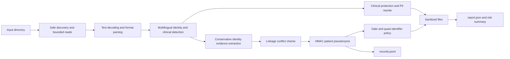

# AarogyaKey — Healthcare Data Privacy Firewall

AarogyaKey is an offline Python application for sanitizing healthcare datasets before release. It scans supported files, detects patient and relative identifiers, protects recognized clinical information, links records when there is enough identity evidence, applies configured privacy transformations, and writes the required output package.

The implementation is designed for CPU-only local execution. It does not call cloud services, hosted AI APIs, or an LLM. Its checks are based on the included tests and the organizer's practice data; they do not guarantee privacy or correctness on unseen data.

## Contents

- [Capabilities](#capabilities)
- [Requirements and installation](#requirements-and-installation)
- [Run on your data](#run-on-your-data)
- [Output files](#output-files)
- [How the pipeline works](#how-the-pipeline-works)
- [Privacy and security behavior](#privacy-and-security-behavior)
- [Configuration](#configuration)
- [Testing and official checks](#testing-and-official-checks)
- [Latest verified practice results](#latest-verified-practice-results)
- [Known limitations](#known-limitations)
- [Repository map](#repository-map)

## Capabilities

| Area | Current behavior |
| --- | --- |
| File formats | CSV, TSV, JSON, and plain text (`.txt`). JSON FHIR Bundles receive limited structural handling. |
| Languages | English, Hindi/Devanagari, and Hinglish patterns, including relationship expressions and transliterations represented in the rules. |
| Identity detection | Contextual detection for names, relatives, phone numbers, Aadhaar-like identifiers, ABHA, MRN/UHID, PAN, email, insurance identifiers, dates of birth, and address/location components. |
| Clinical integrity | A dedicated clinical protection layer helps retain recognized medicines, doses, frequencies, diagnoses, procedures, vitals, laboratory values, units, and durations. |
| Linkage | Conservative record linkage using strong identifiers and contextual evidence; weak or conflicting cases may remain unresolved. |
| Pseudonyms | Stable HMAC-derived patient tokens keyed by `RAKSHA_SECRET`. |
| Quasi-identifiers | Patient-consistent date shifts for resolved identities; age and location generalization; configurable risk actions. Exact stay duration is preserved by default. |
| File safety | Bounded no-follow reads, symlink rejection, malformed/unsupported-file quarantine, private output permissions, and privacy-safe structured logs. |

The detector is rule-based and explainable. It does not guarantee detection of every identifier, schema, language variation, image, or opaque attachment.

## Requirements and installation

- Python 3.11 or a compatible Python 3 version supported by the installed dependencies.
- `pip`.
- The packages listed in `requirements.txt` (currently `cryptography` for the security/key-management components).
- A `RAKSHA_SECRET` containing at least 16 UTF-8 bytes.

From the repository root (`AarogyaKey/`):

```bash
python3 -m venv .venv
source .venv/bin/activate
python3 -m pip install --upgrade pip
python3 -m pip install -r requirements.txt
```

On Windows PowerShell, activate the environment with `.venv\Scripts\Activate.ps1` instead of the `source` command.

## Run on your data

Put the files to sanitize in an input directory. The application walks the directory recursively. Keep the output directory outside the input directory; it must be empty or not yet created.

### macOS or Linux

```bash
cd /path/to/AarogyaKey
source .venv/bin/activate

# Generate one high-entropy secret for this shell session.
export RAKSHA_SECRET="$(python3 -c 'import secrets; print(secrets.token_urlsafe(32))')"

INPUT="/absolute/path/to/your/input"
OUTPUT="$(mktemp -d /tmp/aarogyakey-output.XXXXXX)"
python3 main.py --input "$INPUT" --output "$OUTPUT"
printf 'Sanitized output: %s\n' "$OUTPUT"
```

Replace `/absolute/path/to/your/input` with the path to your own folder. The program prints a summary of how many files were sanitized or quarantined and how many records were processed. Per-file log events contain a content hash and status, not the raw record contents.

To inspect the generated files:

```bash
find "$OUTPUT" -maxdepth 4 -type f -print
python3 -m json.tool "$OUTPUT/report.json" | less
```

The sanitized data may still contain sensitive clinical information. Store and share the output with the same care as the source data.

### Keep the secret stable when you need stable identities

Generate the secret once and keep using that same secret for records that must receive consistent pseudonyms and date offsets across runs or hospitals. Generating a new secret changes the pseudonyms and date shifts. If the secret is lost, the previous pseudonyms cannot be reproduced. Store it in a secure secret manager or protected environment configuration; do not put it in source control, command transcripts, shared documents, or logs.

For a later terminal session, retrieve the same secret from your approved secure store and export it before running the program. Do not generate a fresh secret when you need to compare outputs under the same identity mapping.

### Input handling

- Supported extensions are `.csv`, `.tsv`, `.json`, and `.txt`, case-insensitively.
- UTF-8, UTF-8 with BOM, UTF-16 with BOM, and CP1252 text are attempted.
- Symlinks, unsupported extensions, empty files, malformed structured files, files over the configured size limit, and JSON beyond the configured nesting limit are quarantined rather than copied unchanged into `sanitized/`.
- PDFs, scanned images, spreadsheets, and other unsupported formats are **not OCR-processed or sanitized**. They are quarantined. Convert or process them through an explicitly validated workflow before relying on their contents being protected.
- The program does not modify the input tree.

## Output files

The output directory contains:

```text
OUTPUT/
├── sanitized/       # sanitized supported files, retaining directory structure where safe
├── records.jsonl    # one JSON object per processed record/document
└── report.json      # file accounting, counts, privacy actions, timing and resource summary
```

### `sanitized/`

This directory contains rewritten supported files. Names and path components that match PII rules may be replaced with hash-based safe names. Unsupported or failed files are not copied into this directory.

### `records.jsonl`

Each line is a JSON object with the sanitized file path, a record locator, and a linked patient pseudonym when available. A typical shape is:

```json
{"file":"sanitized/registration.csv","loc":"row:2","patient":"PSN-EXAMPLE"}
```

The example token is illustrative only. Records without sufficient linkage evidence can have a `null` patient value. Do not treat null as proof that two records refer to different people.

### `report.json`

The report uses schema `raksha-report/1` and includes:

- Per-file accounting status (`sanitized` or `quarantined`), output path where present, SHA-256 input digest, and a safe quarantine reason where applicable.
- Counts for files, processed records, detected identifiers, linked records, generalized/suppressed records, and quarantine.
- Detection entity counts and privacy action counts.
- Before/after quasi-identifier risk summaries, elapsed time, and process peak RSS.

The report is for accounting and evaluation. It is not a proof that all PII was found or that the output is anonymous.

### Interpreting a custom-data run

`sanitized/` is the transformed dataset to inspect. The terminal summary and `report.json` explain which files were processed or quarantined; they are not a side-by-side comparison against a dataset generator's `expected_results.json`. The repository does not include a universal expected-results comparator because custom expected-result files use dataset-specific schemas. Use the data provider's evaluator when available, and review both privacy leakage and clinical-value retention rather than treating “sanitized” as a pass/fail quality score.

## How the pipeline works



1. **Discover and validate files.** Files are traversed in stable order. Reads are bounded and avoid following symlinks. Unsafe, malformed, empty, and unsupported input is isolated as a quarantine result.
2. **Parse and detect.** CSV/TSV headers and values, JSON keys and nested values, and text are inspected with language- and context-aware rules. Clinical contexts are considered to reduce false redaction of medicines and providers.
3. **Resolve identities.** Candidate records are compared using names, dates, strong identifiers, hospital namespaces, and conflict checks. Weak evidence alone is not enough to merge.
4. **Pseudonymize and protect quasi-identifiers.** Resolved records receive HMAC-based stable identifiers. Applicable dates are shifted consistently per resolved patient; age, PIN/location, and other configured fields are generalized or suppressed according to policy.
5. **Rewrite and report.** Supported input files are serialized under `sanitized/`. The pipeline writes record locators and a report, then checks output permissions, symlinks, temporary artifacts, and raw-secret leakage.

## Privacy and security behavior

### Multilingual PII detection

Detection includes contextual field/header rules and content patterns for patient and relative names, relationship phrases such as S/o, D/o, W/o and C/o, phone numbers, Aadhaar-like values, ABHA values, MRN/UHID and other record identifiers, PAN, email, insurance identifiers, dates of birth, and address details such as house numbers, landmarks, villages, localities, and PIN codes. Hindi and Hinglish labels are covered by explicit rules and normalization behavior.

Person-name decisions use labels, nearby relationship or patient context, record structure, and clinical-field context. Capitalization by itself is not a sufficient signal. This lowers false positives but means an unseen name or unusual shorthand can still be missed.

### Clinical information protection

Medical-value rules protect recognized clinical fields and patterns so that medicines, doses, frequencies, diagnoses, procedures, observations, vitals, lab values, units, and treatment durations can survive sanitization. The protection is heuristic; unfamiliar schemas, ambiguous free text, or a value that looks like an identifier can still be misclassified. The practice checker and regression tests are evidence for tested inputs only.

### Linkage and pseudonyms

The linkage resolver prioritizes precision and rejects hard conflicts. An exact MRN within the same inferred hospital namespace can link records when there is no contradictory date of birth, global identifier, or incompatible name. Identifier values are scoped where appropriate because local MRN/insurance numbers can repeat at different hospitals. Name-only or otherwise weak matches can remain unresolved.

Patient pseudonyms are HMAC-derived using a purpose-specific key derived from `RAKSHA_SECRET`. The same secret and identity anchor produce stable pseudonyms; changing the secret changes them. Pseudonyms are identifiers, not encryption of the source data.

### Dates, age, location, and stay duration

- Dates for linked patients use deterministic patient-specific day offsets, preserving relative date intervals within the records processed for that patient.
- Records without resolved patient identity use coarse date precision from the configured policy, rather than a patient-specific shift.
- Age is generalized into configured bands, with special handling for minors and older adults.
- PIN codes and residential location details are reduced or suppressed according to field context and available coarser geography.
- Exact length-of-stay values are preserved by default for clinical fidelity. Setting `preserve_exact_stay_duration: false` opts into risk-driven stay bucketing; that option can reduce clinical detail.
- Rare diagnosis generalization defaults to `preserve`; no automatic ontology-backed generalization is claimed.

Quasi-identifier summaries are diagnostic measurements over available records and fields. Small synthetic cohorts and low measured uniqueness do not prove anonymity or resistance to arbitrary auxiliary information.

### Secrets, logs, and filesystem controls

- `RAKSHA_SECRET` must be present and at least 16 UTF-8 bytes. Separate HKDF purposes are used for pseudonyms, date shifts, and the encryption helper.
- The CLI emits structured per-file events using content hashes, statuses, and safe reason categories. It avoids printing raw records and catches processing failures with a fixed generic message.
- Output directories and files are created with restrictive permissions and atomically published. Input reads are size-limited and no-follow; symlinks are quarantined.
- Intermediate identity evidence is held in process memory by the current pipeline. The AES-GCM authenticated-encryption utility exists for sensitive data that must be persisted, but the live pipeline does not currently persist those intermediates or use that utility.
- Python memory erasure, operating-system swap protection, and secure deletion on SSDs/filesystems are not guaranteed.

## Configuration

Runtime policy is loaded from [`config/policy.yaml`](config/policy.yaml). Current settings:

| Setting | Default | Meaning |
| --- | ---: | --- |
| `max_file_bytes` | 52,428,800 | Maximum file size accepted for processing (50 MiB). |
| `max_json_depth` | 100 | Maximum nested JSON depth. |
| `date_shift_max_days` | 365 | Maximum magnitude used to derive a patient-specific date offset. |
| `age_band_years` | 5 | Adult age-band width. |
| `senior_age_from` | 85 | Age at which the `85+` band begins. |
| `minor_age_boundaries` | `0,5,10,15,18` | Boundaries for child age bands. |
| `pin_prefix_digits` | 3 | Number of PIN digits retained for non-FHIR location generalization. |
| `minimum_equivalence_class` | 3 | Threshold used by risk-driven transformations. |
| `rare_diagnosis_max_count` | 2 | Frequency threshold for configured rare-diagnosis policy. |
| `rare_diagnosis_action` | `preserve` | Default is to preserve diagnosis values. |
| `preserve_exact_stay_duration` | `true` | Preserve exact stays unless explicitly opted into bucketing. |
| `unresolved_date_precision` | `month` | Date precision for records without a resolved patient. |

The loader supports simple `key: value` scalar entries; it is not a general YAML implementation. Change policy values only after reviewing their clinical and privacy effects and rerunning the checks.

## Testing and official checks

Run unit tests, compilation, and the independent synthetic adversarial suite from the repository root:

```bash
python3 -m unittest discover -s tests -v
python3 -m compileall -q src tools tests main.py
python3 tools/adversarial_suite.py \
  --seeds 61027 93811 \
  --varied-seeds 28697 74671 \
  --summary /tmp/aarogyakey-adversarial-summary.json
```

The adversarial suite generates synthetic records. Do not add generated outputs or organizer practice data to Git.

If the ignored organizer kit is present locally, run its checks from the repository root:

```bash
export RAKSHA_SECRET="$(python3 -c 'import secrets; print(secrets.token_urlsafe(32))')"
OUTPUT="$(mktemp -d /tmp/aarogyakey-practice.XXXXXX)"

python3 main.py \
  --input .local-evaluation/official-kit/dev/input \
  --output "$OUTPUT"
python3 .local-evaluation/official-kit/validate_output.py \
  --input .local-evaluation/official-kit/dev/input \
  --output "$OUTPUT"
python3 .local-evaluation/official-kit/check_dev.py --output "$OUTPUT"
python3 .local-evaluation/official-kit/check_submission.py --repo . --run
```

The contract validator checks output structure and accounting. The practice checker measures known practice PII surfaces, canaries, medical probes, linkage, and raw-copy behavior. The three-run checker checks the configured run command, output contract, repeatability with the same secret, changed-secret behavior, and input immutability. These checks have different purposes; a `CONTRACT OK` result alone does not measure privacy.

The organizer kit is git-ignored and is not included in a clone. Do not commit it: it contains practice data and answer-key material. The submission checker only detects whether a PDF exists; it does not establish that it is the final Project Brief or inspect the PDF's content. The final Project Brief is prepared separately and must be checked against the organizer's written requirements.

## Latest verified practice results

The latest local practice run recorded:

- PII surfaces visible: **0 / 3,230**.
- Practice canaries visible: **0 / 4**.
- Medical probes preserved: **4,855 / 4,855**.
- Linkage precision / recall / F0.5: **1.00 / 0.36 / 0.74**.
- Wrong merges observed by the practice checker: **0**.
- Output validator: **`CONTRACT OK`**.
- Official three-run checker: **`READY TO SUBMIT`** for its software checks.
- Unit tests: **101 passed**; compilation passed.

These are local practice/synthetic results, not organizer hidden-test results. The same evaluation identified high singleton rates in small re-identification cohorts (22/36 on one fixed cohort and 36/36 on a varied cohort), incomplete linkage recall, and partial rather than comprehensive FHIR validation. Review [`submission_docs/EVALUATION.md`](submission_docs/EVALUATION.md) for the consolidated evidence and limitations. The final external Project Brief is not validated by this README or by the checker’s PDF-presence result.

## Known limitations

- Practice and synthetic test performance does not predict hidden-data performance or guarantee that every PII surface is removed.
- Linkage recall is incomplete. Conservative matching can leave true patient links unresolved; zero observed false merges in tested samples does not guarantee zero future false merges.
- Re-identification risk remains material. Tested generalization did not reduce singleton counts on the reported 36-record cohorts without broader information loss.
- FHIR Bundle handling is limited and is **not** comprehensive FHIR R4 schema, terminology, or reference validation.
- There is no universal output PII scanner for arbitrary new schemas, encrypted/opaque attachments, PDFs, images, or unsupported formats.
- Exact stay duration is preserved by default and may remain a quasi-identifier when combined with age, location, hospital, dates, or diagnosis.
- The AES-GCM persistence helper is available but unused by the current in-memory processing pipeline. Python memory, swap, and secure deletion guarantees are outside scope.
- The report's local runtime and RSS measurements do not establish resource behavior on organizer hidden data or across the entire process tree.
- The checker’s Project Brief PDF-presence result does not validate the final separate Google Docs brief.

## Repository map

```text
main.py                    CLI entry point
src/pipeline.py            Discovery, parsing, orchestration, output and report
src/detection/              PII detector, normalization and medical-value rules
src/linkage/                Identity extraction, resolution and pseudonymization
src/privacy/                Date shifts, generalization, actions and risk summaries
src/security/               Secret derivation, filesystem safety, logging, AES-GCM helper
config/policy.yaml          Runtime privacy and safety policy
tests/                      Unit, regression, security and adversarial tests
tools/adversarial_suite.py  Independent synthetic test-data generator and evaluator
submission_docs/            Curated architecture, privacy, security and evaluation docs
raksha.toml                 Organizer setup and run commands
```

Internal phase notes and the local organizer kit are excluded from Git. Curated project documentation is in `submission_docs/`.
