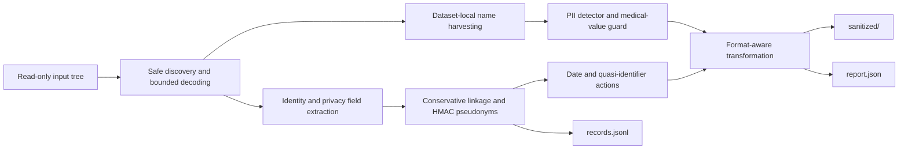

# Architecture

Raksha is an offline, deterministic privacy-processing command line program. It uses Python and a small cryptography dependency; the configured run path makes no model, cloud, or network calls.

## Data flow

The implementation is in `src/`. `main.py` loads the policy, obtains `RAKSHA_SECRET` from the environment, and calls `src.pipeline`. Processing is deterministic for the same input, policy, and secret. The secret affects pseudonyms and patient date shifts.

## Ingestion and serialization

The pipeline recursively discovers `.csv`, `.tsv`, `.json`, and `.txt` files. It decodes UTF-8, UTF-8 BOM, UTF-16, and cp1252, applies configured byte and JSON-depth limits, and avoids following symlinks. Unsafe, malformed, unsupported, empty, oversized, and over-depth inputs are reported as quarantined; raw quarantine copies are not exported. Sanitized files are UTF-8 and are written using private temporary files and atomic replacement. Filename changes are declared in the report.

FHIR-like JSON Bundles are recognized and transformed using resource-aware rules. The current implementation does **not** perform comprehensive FHIR R4 schema validation or guarantee all reference invariants; this is a known limitation.

## Resolution and outputs

Identity evidence is extracted per record and resolved conservatively. Linked records receive stable secret-keyed pseudonyms; uncertain records can remain unresolved. Privacy actions are applied during format-aware rewriting. The required outputs are `sanitized/`, `report.json`, and `records.jsonl`, following the organizer contract. The report includes file hashes/statuses, aggregate counts, privacy-risk summaries, elapsed time, and process peak RSS.

## Runtime

The pipeline is single-process and CPU-only. The configured runtime is `python3 main.py --input {input} --output {output}`. Observed local practice runtime is about 5–6 seconds for 200 files; this is a sample observation, not a bound for hidden inputs. Memory and time limits are enforced by the organizer environment, not by an internal whole-process-tree watchdog.
